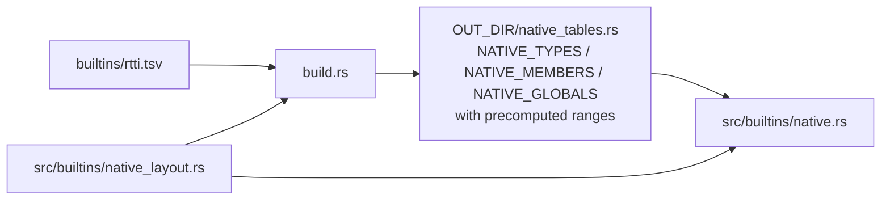

# Built-in types

**File:** [src/builtins.rs](../../src/builtins.rs)

WitcherScript has engine types with no declaration in user code or shipped game scripts. The LSP synthesises their definitions so completion, hover, and go-to-definition work on them.

## Sources

| Source              | Content                                                                                                    |
| ------------------- | ---------------------------------------------------------------------------------------------------------- |
| `builtins/rtti.tsv` | Every native type, member, enum option and global function. Generated by `rtti-gen` from an RTTI XML dump. |
| `builtins/array.ws` | `array<T>`, the only builtin needing special handling in code (generic element-type substitution)          |

### `rtti.tsv` rows

| Record | Columns           | Meaning                      |
| ------ | ----------------- | ---------------------------- |
| `N`    | name              | Simple native type           |
| `C`    | name, base, flags | Class (`a` flag = abstract)  |
| `S`    | name              | Struct                       |
| `E`    | name              | Enum                         |
| `F`    | name, type        | Field of the preceding type  |
| `M`    | name              | Method of the preceding type |
| `O`    | name, value       | Option of the preceding enum |
| `G`    | name              | Global function              |

## Build-time compilation

- `build.rs` parses the TSV (failing the build on unknown records or orphan members) and emits flat static tables.
- Symbol ranges are computed at build time by running the shared `native_layout` renderer, the same code that renders text at runtime, so ranges always match the served text.
- No TSV parsing and no `.ws` text generation happens at startup.

## Loading

- `build_builtins_index()` materialises `Symbol`s from the static tables (one document per native type plus `globals`) and parses `array.ws`, into a `WorkspaceIndex` keyed by `witcherscript-builtin:/<name>.ws`. Runs once behind the `BUILTINS` `LazyLock`.
- `builtin_source(uri)` renders the `.ws` text for one document on demand.
- `is_builtin_uri(uri)` is the cheap guard; use it instead of `builtin_source(..).is_some()`.

Tests opt in via `SymbolDb::new(&ws, &base).with_builtins(&builtins)`.

## Guardrails

- `prepare_rename` and `rename` reject any symbol whose URI is a builtin URI (`is_builtin_uri`).
- `rename_changes` filters out reference sites inside a builtin document.
- `SymbolDb::all_types()` includes builtin types but excludes `is_non_type_builtin()` (`array`, only valid as `array<T>`).

## Updating native builtins

1. Produce `target/tmp/rttidump.xml`.
2. Run `just rtti` to regenerate `builtins/rtti.tsv`.
3. Rebuild; `build.rs` recompiles the tables.
